# フロントエンド設計書

持ち越しの推移を表示する画面（[mk002_daily-tasks_web-next](https://github.com/KenichiroArai/mk002_daily-tasks_web-next)）の設計書です。
内容は mk002_daily-tasks_web-next の `src/` の現状の実装を正として記述しています。実装を変更した場合は、関係する章もあわせて更新してください。

## 目的

GitHub Issue（1 日 1 Issue）で管理している日々のタスクのうち、「持ち越し」（旧「繰り越し」「負債」）の件数と残り時間の推移を、グラフと表で確認できるようにします。

- 表示するデータは、Java の収集ツールが daily-tasks-git に出力する `docs/data/summary.json`（日別集計）だけです
- 画面はデータを読み取るだけで、変更はしません
- GitHub Pages に静的サイトとして公開します

## 対象範囲

対象は mk002_daily-tasks_web-next の次のファイルです。

| 対象                         | 説明                                                              |
| ---------------------------- | ----------------------------------------------------------------- |
| `src/`                       | 画面のソースコード（ルーティング、機能、共通部品、設定）          |
| `scripts/`                   | データのコピー（daily-tasks-git の `docs/data` -> `public/data`） |
| リポジトリ直下の設定ファイル | Next.js、TypeScript、ESLint、Prettier、Vitest の設定              |

Java の収集ツール（Issue の取得・解析・集計）は対象外です。[gr002_daily-tasks](https://github.com/KenichiroArai/gr002_daily-tasks) と [Issue 解析の仕様](carryover-spec.md) を参照してください。

## 技術スタック

| 分類           | 採用技術                                                        |
| -------------- | --------------------------------------------------------------- |
| フレームワーク | Next.js 16（App Router、`output: 'export'` の静的エクスポート） |
| 言語・UI       | TypeScript 5、React 19                                          |
| グラフ         | Recharts 3                                                      |
| データの検証   | zod 4                                                           |
| スタイル       | CSS Modules、`styles/globals.css`（CSS 変数）                   |
| テスト         | Vitest 5、Testing Library、jsdom                                |
| 静的解析・整形 | ESLint 9（`eslint-config-next`）、Prettier 3                    |
| 実行環境       | Node.js 20.9 以降（CI は 22）                                   |
| 公開           | GitHub Pages（GitHub Actions でデプロイ）                       |

## 設計書の構成

| 章                                         | 内容                                                                                   |
| ------------------------------------------ | -------------------------------------------------------------------------------------- |
| [01. 全体構成](design/01-architecture.md)  | ディレクトリ構成、依存の向き、静的エクスポートと basePath                              |
| [02. データ設計](design/02-data.md)        | データの流れ、`summary.json` のスキーマ、検証とエラー表示                              |
| [03. 画面設計](design/03-screen.md)        | 画面構成、表示条件（表示・指標・集計・対象・期間）、URL クエリ                         |
| [04. モジュール設計](design/04-modules.md) | 状態管理、フック、`lib/` の純粋関数、コンポーネント、定数                              |
| [05. 品質・運用](design/05-quality.md)     | テスト、静的解析、コーディングルール、npm スクリプト、ビルドとデプロイ、機能の追加手順 |

## 全体像

```mermaid
flowchart LR
  issues["GitHub Issue"] --> collector["Java 収集ツール（gr002）"]
  collector --> summaryJson["daily-tasks-git の docs/data/summary.json"]
  summaryJson --> copyData["scripts/copy-data.mjs（mk002）"]
  copyData --> publicData["public/data/"]
  publicData --> build["next build（静的エクスポート）"]
  build --> out["out/"]
  out --> pages["GitHub Pages"]
  pages --> browser["ブラウザ"]
  browser -->|"fetch summary.json"| pages
```

## 関連ドキュメント

- [全体構成](overview.md): リポジトリの役割と関係、データの流れ
- [mk002_daily-tasks_web-next の AGENTS.md](https://github.com/KenichiroArai/mk002_daily-tasks_web-next/blob/main/AGENTS.md): 画面の作業ガイド（構成ルール、TypeScript のコーディングルール）
- [gr002_daily-tasks の AGENTS.md](https://github.com/KenichiroArai/gr002_daily-tasks/blob/main/AGENTS.md): Java の収集ツールの作業ガイド
- [daily-tasks-git の README.md](https://github.com/KenichiroArai/daily-tasks-git/blob/main/README.md): 使い方とセットアップ
