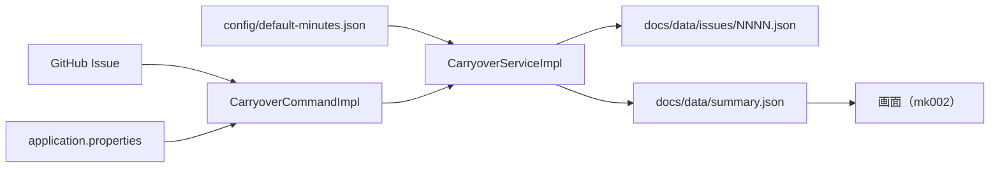

# バックエンド設計書

[設計書の入口へ戻る](../design.md)

日々のタスクの「持ち越し」を集計する収集ツール（[gr002_daily-tasks](https://github.com/KenichiroArai/gr002_daily-tasks)）の設計書です。
内容は gr002_daily-tasks の `src/main/java` と `src/main/resources` の現状の実装を正として記述しています。実装を変更した場合は、関係する章もあわせて更新してください。

## 目的

GitHub Issue（1 日 1 Issue）で管理している日々のタスクのうち、「持ち越し」（旧「繰り越し」「負債」）を Issue 本文から収集・解析し、画面が読む JSON を出力します。

- 入力は daily-tasks-git の Issue と `config/default-minutes.json` です
- 出力は daily-tasks-git の `docs/data/` です。収集ツール以外は、この JSON を手で編集しません
- Web サーバーは起動しません。Spring Boot のコマンドラインツールとして動きます

## 対象範囲

対象は gr002_daily-tasks の次のファイルです。

| 対象                    | 説明                                                         |
| ----------------------- | ------------------------------------------------------------ |
| `src/main/java/`        | 収集・解析・集計・入出力のソースコード                       |
| `src/main/resources/`   | 設定（`application.properties`）とメッセージ                 |
| `src/test/java/`        | テストと、層のルールを検査する `ArchitectureTest`            |
| `pom.xml`               | Java、Spring Boot、JaCoCo、ArchUnit の設定                   |

画面（`summary.json` の表示）は対象外です。[フロントエンド設計書](frontend.md) を参照してください。
Issue 本文の解析ルールと JSON の項目定義は [Issue 解析の仕様](../carryover-spec.md) を参照してください。

## 技術スタック

| 分類           | 採用技術                                                                                          |
| -------------- | ------------------------------------------------------------------------------------------------- |
| 言語           | Java 25                                                                                           |
| フレームワーク | Spring Boot 4.1（`spring-boot-starter`。DI、設定のバインド、メッセージ。Web サーバーは起動しない） |
| ビルド         | Maven（`spring-boot-maven-plugin` で実行可能 jar を作る）                                         |
| JSON           | Jackson 3（`spring-boot-starter-jackson`。パッケージは `tools.jackson.*`）                        |
| HTTP           | `java.net.http.HttpClient`（GitHub REST API）                                                     |
| ログ           | SLF4J + Logback                                                                                   |
| 共通型         | kmg-fund 0.3.1（kmg-core 0.3.2 は kmg-fund が依存し、kmg-fund に無い型だけ直接使う）              |
| テスト         | JUnit 5、JaCoCo 0.8.14（行・分岐 100%）、ArchUnit 1.4.1                                           |
| 成果物         | `kmg.gr.gr002` : `gr002_daily-tasks` : `0.1.0`                                                    |

## 設計書の構成

| 章                                           | 内容                                                                                 |
| -------------------------------------------- | ------------------------------------------------------------------------------------ |
| [01. 全体構成](backend/01-architecture.md)   | ディレクトリ構成、5 層のコンポーネント、処理の流れと依存の向き、起動                 |
| [02. データ設計](backend/02-data.md)         | 入出力ファイル、設定の引き継ぎ、モデルのクラス図、DTO・JSON の変換                   |
| [03. 収集処理](backend/03-processing.md)     | コマンド引数、収集と取得・保存のシーケンス、差分判定、集計                           |
| [04. モジュール設計](backend/04-modules.md)  | 層ごとのクラス図と役割                                                               |
| [05. 品質・運用](backend/05-quality.md)      | テスト、ArchUnit、メッセージ、ビルドと実行                                           |

## 全体像

## 関連ドキュメント

- [設計書の入口](../design.md): フロントエンド設計書とバックエンド設計書の案内
- [全体構成](../overview.md): リポジトリの役割と関係、データの流れ
- [Issue 解析の仕様](../carryover-spec.md): 対象セクション、時間表記、収集のモード、JSON の形式
- [gr002_daily-tasks の AGENTS.md](https://github.com/KenichiroArai/gr002_daily-tasks/blob/main/AGENTS.md): パッケージ構成、コーディングルール、テストの書き方
- [フロントエンド設計書](frontend.md): 画面が `summary.json` を読むときの設計
