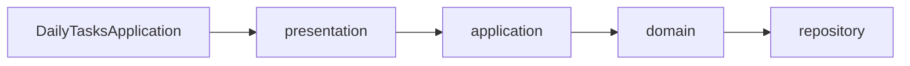
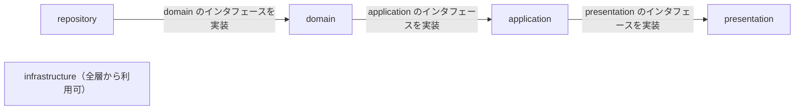

# 01. 全体構成

[設計書の目次へ戻る](../backend.md)

## ディレクトリ構成

ルートパッケージは `kmg.gr.gr002.dailytasks` です。業務のクラスは機能パッケージ `carryover` の中に置き、起動クラスだけを直下に置きます。

```text
gr002_daily-tasks/
  pom.xml
  launch/                         # Eclipse の実行の構成
  src/main/java/kmg/gr/gr002/dailytasks/
    DailyTasksApplication.java    # 起動クラス（Spring Boot を起動するだけ）
    carryover/
      presentation/               # CLI などの入出力層
        command/                  # CarryoverCommand
        command/impl/             # CarryoverCommandImpl
        model/                    # CarryoverPropertiesModel
        service/                  # CarryoverService（実装は application）
        types/                    # CommandOptionTypes、CarryoverPropertiesFormatTypes
      application/                # ユースケース
        service/impl/             # CarryoverServiceImpl
        logic/                    # CarryoverIssueLogic、CarryoverParseLogic、CarryoverAggregateLogic
        model/                    # Issue、持ち越し項目、日別集計、標準時間、取得元
        types/                    # MinutesSourceTypes、IssueStateTypes、CarryoverSourceFormatTypes
      domain/                     # 共通ロジック
        logic/impl/               # 取得・保存、解析、集計の実装
        repository/api/           # GitHubIssueApi
        repository/dao/           # CarryoverDataDao、DefaultMinutesDao
        dto/                      # repository と受け渡す DTO
        types/                    # 対象セクション、解析の正規表現と固定文字列
      infrastructure/             # 業務を知らない汎用の部品
        logic/                    # MessageLogic
        logic/impl/               # MessageLogicImpl
        types/msg/                # Gr002GenMsgTypes、Gr002LogMsgTypes、Gr002ValMsgTypes
      repository/                 # データアクセス
        api/github/               # GitHubIssueApiImpl
        dao/carryoverdata/        # CarryoverDataDaoImpl
        dao/defaultminutes/       # DefaultMinutesDaoImpl
        dto/json/                 # Jackson のアノテーションを持つ JSON の形
        logic/                    # CarryoverJsonConvertLogic
        types/                    # 出力ファイル名、GitHub API の URL・ヘッダ
  src/main/resources/
    application.properties
    messages.properties
    messages-log.properties
    logback-spring.xml
```

各層の役割は次のとおりです。

| 層                 | 役割                                                                 |
| ------------------ | -------------------------------------------------------------------- |
| `presentation/`    | コマンドライン引数と設定ファイルを受け取り、収集を始める             |
| `application/`     | 取得、解析、保存、集計の一連の流れを組み立てる                       |
| `domain/`          | 解析、集計。モデルと DTO の変換は変換先の型が行う。repository に求めるインタフェースを持つ |
| `infrastructure/`  | メッセージの取得。業務の判断や機能固有の設定値は持たない             |
| `repository/`      | GitHub REST API と JSON ファイルへのアクセス                         |

読み書きするファイルは daily-tasks-git にあります。jar は daily-tasks-git をカレントディレクトリにして実行します。

```text
daily-tasks-git/
  config/default-minutes.json    # 時間表記がない行を補完する項目ごとの標準時間
  docs/data/issues/NNNN.json     # Issue ごとの解析結果（4 桁ゼロ埋め）
  docs/data/summary.json         # 画面用の日別集計
```

## 処理の流れと依存の向き

処理の呼び出しは上から下へ進みます。依存（import）はその逆で、すぐ上の層だけを参照します。下の層を差し替えても、上の層のコードは変えません。





| 呼ぶ側         | 自層に置くもの                                      | 実装する層     |
| -------------- | --------------------------------------------------- | -------------- |
| presentation   | `CarryoverService`、`CarryoverPropertiesModel`      | application    |
| application    | 取得・解析・集計のロジック、業務モデル              | domain         |
| domain         | `GitHubIssueApi`、DAO、DTO                          | repository     |

- infrastructure は全層から参照してよい。infrastructure から他の層は参照しない
- 層の飛び越しと、処理の流れと同じ向きの参照は禁止する
- これらの制限は [ArchitectureTest](https://github.com/KenichiroArai/gr002_daily-tasks/blob/main/src/test/java/kmg/gr/gr002/dailytasks/ArchitectureTest.java) で検査する（[05. 品質・運用](05-quality.md)）

## 起動

[DailyTasksApplication](https://github.com/KenichiroArai/gr002_daily-tasks/blob/main/src/main/java/kmg/gr/gr002/dailytasks/DailyTasksApplication.java) は `SpringApplication.run` を呼ぶだけです。`@ConfigurationPropertiesScan` で presentation の設定クラスを読み込みます。

[application.properties](https://github.com/KenichiroArai/gr002_daily-tasks/blob/main/src/main/resources/application.properties) では、Web サーバーを起動しないように次を設定しています。

| 設定                                  | 値                         |
| ------------------------------------- | -------------------------- |
| `spring.main.web-application-type`    | `none`                     |
| `spring.main.banner-mode`             | `off`                      |
| `spring.main.log-startup-info`        | `false`                    |
| `spring.messages.basename`            | `messages,messages-log`    |
| `spring.messages.encoding`            | `UTF-8`                    |

起動後、Spring が `CommandLineRunner` である [CarryoverCommandImpl](https://github.com/KenichiroArai/gr002_daily-tasks/blob/main/src/main/java/kmg/gr/gr002/dailytasks/carryover/presentation/command/impl/CarryoverCommandImpl.java) の `run` を呼びます。引数の解釈と収集の手順は [03. 収集処理](03-processing.md) です。

## DI

実装クラスは Spring の Bean として登録し、インスタンス変数の `@Autowired` で受け取ります。コンストラクタでは依存を受け取りません。自分で `new` して下の層の実装を作りません。

| 種類                         | アノテーション |
| ---------------------------- | -------------- |
| コマンド、ロジック           | `@Component`   |
| サービス（`service/impl/`）  | `@Service`     |
| 外部 API と DAO の実装       | `@Repository`  |

受け取る型は、自層のインタフェースです。実装は Spring が下の層から注入します。`@Autowired` は注入するインスタンス変数に付けます。その変数は `final` にしません。Spring が注入しないインスタンス変数のうち、生成時に決まるものは、デバッグしやすいようにコンストラクタで初期化します。ロガーと、値が変動しないクラス変数（固定の定数、`Pattern.compile`、列挙型からの取得など）はフィールドの初期値にしてよいです。列挙型の `VALUES_MAP` のように、クラス変数へインスタンスを入れるだけのものもフィールドの初期値にしてよいです。ハッシュ値の算出のように計算結果を求めるものは static 初期化子で代入します。

インスタンスの生存期間で共通な情報（複数メソッドで同じ値を使う値、そのオブジェクトが何に対する処理かを決める値）は `initialize` で受け取り、フィールドに保持します。コンストラクタではこの情報を受け取りません。`initialize` の戻り値は void で、失敗は例外です。

- 共同作業者（ロジック、DAO、API、`MessageLogic`）は `@Autowired` のフィールドとし、`initialize` の引数にしない
- メソッドごとに変わる入力（1 件の Issue、保存する解析結果、集計そのもの）は引数のままにする
- 1 メソッドの中だけで使う計算結果はローカル変数のままにする

状態を持つ Bean（`initialize` でフィールドを持つサービス、ロジック、外部 API、DAO）は `@Scope("prototype")` にします。シングルトンのままフィールドへ書くと、次の実行が前の設定を上書きするためです。シングルトンが prototype を使うときは `ObjectProvider` で実行のたびに新しいインスタンスを取り、`initialize` してから処理します。prototype を prototype へ `@Autowired` する場合は、親の生成時に子も 1 つ作られるので、`ObjectProvider` にはしません。呼び出し元が持っている情報は `initialize` で渡し、処理の途中で得て以降の呼び出しで共通になる情報は、その時点で下位の `initialize` に渡します。
