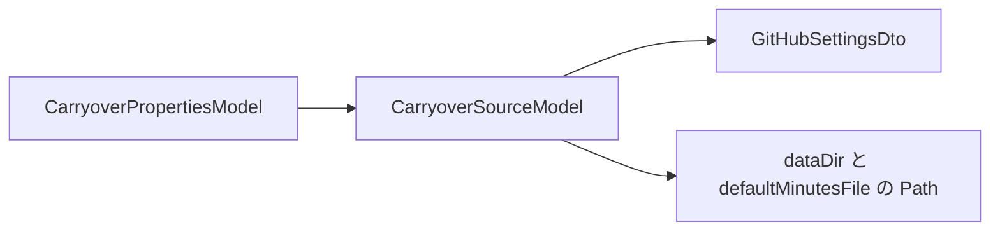
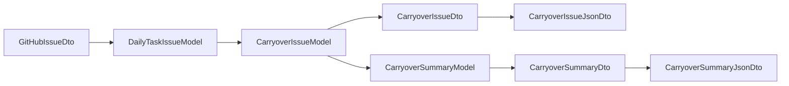

# 02. データ設計

[設計書の目次へ戻る](../backend.md)

## 基本方針

- 設定値も業務データも、上の層から下の層へ引き継ぎます。境界では、呼ぶ側の層の型に変換してから渡します。引き継ぎは `initialize` で行い、受け取った側はフィールドに保持します。メソッドごとの対象は引数で渡します
- JSON の形（Jackson のアノテーション）は `repository/dto/json/` だけが持ちます。domain の DTO には付けません
- 出力する JSON の項目定義は [Issue 解析の仕様](../../carryover-spec.md) に書きます。画面が読むときの検証は [フロントエンド設計書の 02. データ設計](../frontend/02-data.md) です

## 入出力ファイル

jar のカレントディレクトリは daily-tasks-git のルートです。パスは [CarryoverPropertiesModel](https://github.com/KenichiroArai/gr002_daily-tasks/blob/main/src/main/java/kmg/gr/gr002/dailytasks/carryover/presentation/model/CarryoverPropertiesModel.java) が設定の文字列から `Path` に変換します。

| ファイル                         | 方向 | 内容                                       | 主な利用者                         |
| -------------------------------- | ---- | ------------------------------------------ | ---------------------------------- |
| `config/default-minutes.json`    | 読取 | 項目名と標準時間（分）の対応               | 時間表記がない行の補完             |
| `docs/data/issues/NNNN.json`     | 読書 | Issue ごとの解析結果。ファイル名は `%04d`  | 差分モードの更新判定、次回の収集   |
| `docs/data/summary.json`         | 書込 | 日別集計                                   | 画面（mk002）                      |

Issue ごとのファイル名は [CarryoverDataFileTypes](https://github.com/KenichiroArai/gr002_daily-tasks/blob/main/src/main/java/kmg/gr/gr002/dailytasks/carryover/repository/types/CarryoverDataFileTypes.java) と [CarryoverDataFormatTypes](https://github.com/KenichiroArai/gr002_daily-tasks/blob/main/src/main/java/kmg/gr/gr002/dailytasks/carryover/repository/types/CarryoverDataFormatTypes.java) で決めます。ディレクトリ名は `issues`、拡張子は `.json`、集計ファイル名は `summary.json`、Issue ファイル名は 4 桁ゼロ埋めです。

## 設定の引き継ぎ

設定の出どころは presentation だけです。`application.properties` の `carryover.*` を `CarryoverPropertiesModel`（`@ConfigurationProperties`）が受け取ります。`@Value` では個別に読みません。

| キー                            | 既定値                              | 意味                                                 |
| ------------------------------- | ----------------------------------- | ---------------------------------------------------- |
| `carryover.repository`          | `KenichiroArai/daily-tasks-git`     | 対象リポジトリ（`owner/name`）                       |
| `carryover.token`               | `${GITHUB_TOKEN:}`                  | GitHub API のトークン。未設定なら認証なし           |
| `carryover.dataDir`             | `docs/data`                         | 出力先ディレクトリ                                   |
| `carryover.defaultMinutesFile`  | `config/default-minutes.json`       | 標準時間の設定ファイル                               |
| `carryover.recentCount`         | `10`                                | 差分モードで毎回解析し直す最新 Issue の件数          |

Spring Boot の仕組みで、環境変数から上書きできます（例: `CARRYOVER_RECENTCOUNT`）。トークンは設定型の `toString` に含めません。

境界ごとの型は次のとおりです。

| 境界                      | 型                      | 渡すもの                                           |
| ------------------------- | ----------------------- | -------------------------------------------------- |
| presentation → application | `CarryoverPropertiesModel` | リポジトリ、トークン、出力先、標準時間のファイル、最新件数、全件モードか |
| application → domain      | `CarryoverSourceModel`  | リポジトリ、トークン、出力先の `Path`、標準時間ファイルの `Path` |
| domain → repository       | `GitHubSettingsDto`、`Path` | API にはリポジトリとトークン。ファイルにはパス     |

受け取る側がフィールドに保持するものは次のとおりです。

| 初期化                                         | フィールド                                      |
| ---------------------------------------------- | ----------------------------------------------- |
| `CarryoverService.initialize(properties, full)` | 取得元（`CarryoverSourceModel`）、`recentCount`、全件モードか |
| `CarryoverIssueLogic.initialize(source)`       | 取得元と保存先。同時に外部 API と DAO を初期化する |
| `CarryoverParseLogic.initialize(defaultMinutes)` | 標準時間。収集の途中で読んだあと、`collect` の中で渡す |
| `GitHubIssueApi.initialize(settings)`          | 接続設定                                        |
| `CarryoverDataDao.initialize(dataDir)`         | 出力先のディレクトリ                            |
| `DefaultMinutesDao.initialize(configFile)`     | 標準時間の設定ファイル                          |

`recentCount` と全件モードかは application の差分判定で使い、domain へは渡しません。変換は [CarryoverServiceImpl](https://github.com/KenichiroArai/gr002_daily-tasks/blob/main/src/main/java/kmg/gr/gr002/dailytasks/carryover/application/service/impl/CarryoverServiceImpl.java) の `toSource` と [CarryoverDtoConvertLogic](https://github.com/KenichiroArai/gr002_daily-tasks/blob/main/src/main/java/kmg/gr/gr002/dailytasks/carryover/domain/logic/CarryoverDtoConvertLogic.java) の `toGitHubSettingsDto` が行います。`toSource` はサービスの `initialize` の中で、`toGitHubSettingsDto` は取得・保存ロジックの `initialize` の中で呼びます。

## 業務データの変換

処理の途中では application のモデルを使い、repository との境界では domain の DTO を使います。JSON へ書く直前に repository の JSON 用 DTO へ変換します。

| 変換                         | 担当                         | 内容                                                                 |
| ---------------------------- | ---------------------------- | -------------------------------------------------------------------- |
| GitHub の応答 → モデル       | `CarryoverDtoConvertLogic`   | `GitHubIssueDto` を `DailyTaskIssueModel` にする                     |
| モデル → 保存用 DTO          | `CarryoverDtoConvertLogic`   | 件数と残り時間の合計は、項目のリストから `getCount` と `getMinutes` で求める |
| 保存用 DTO → モデル          | `CarryoverDtoConvertLogic`   | `minutesSource` の文字列を `MinutesSourceTypes` にする。不明なら例外 |
| 標準時間の Map → モデル      | `CarryoverDtoConvertLogic`   | `Map<String, Double>` を `DefaultMinutesModel` にする                |
| 集計モデル → DTO             | `CarryoverDtoConvertLogic`   | 日別集計を `CarryoverSummaryDto` にする                              |
| DTO ↔ JSON                   | `CarryoverJsonConvertLogic`  | Issue は読み書きの両方。集計は JSON への書き出しだけを行う           |

GitHub API の応答は、JSON 用の型を作らず、[GitHubIssueApiImpl](https://github.com/KenichiroArai/gr002_daily-tasks/blob/main/src/main/java/kmg/gr/gr002/dailytasks/carryover/repository/api/github/GitHubIssueApiImpl.java) が domain の `GitHubIssueDto` を直接作ります。

## モデル

application のモデルです。JSON の項目名との対応は [Issue 解析の仕様](../../carryover-spec.md) を参照してください。

| 型                     | 主な項目                                                                                          |
| ---------------------- | ------------------------------------------------------------------------------------------------- |
| `DailyTaskIssueModel`  | 番号、タイトル、状態、更新日時、本文                                                              |
| `CarryoverIssueModel`  | 番号、タイトル、日付、状態、更新日時、対象セクション、`declaredCount`、項目のリスト             |
| `CarryoverItemModel`   | 項目名、持ち越し元の日付、チェック、残り時間、取得元、セクション、元の行                       |
| `DefaultMinutesModel`  | 項目名と標準時間（分）の対応                                                                      |
| `CarryoverSummaryModel`| `latestIssue`、項目名の一覧、日別集計                                                             |
| `DailySummaryModel`    | 日付、Issue 番号、`declaredCount`、合計、項目ごと、持ち越し元の月ごと                           |
| `ItemStatModel`        | 件数、残り時間、チェック済みの件数、チェック済みの残り時間                                        |

`CarryoverIssueModel` は件数と残り時間の合計をフィールドに持たず、項目のリストから計算します。保存する DTO と JSON には、その計算結果を `count` と `minutes` として書きます。

`ItemStatModel` は、項目を加えるたびに件数と残り時間を足します。チェック済みの項目だけ、チェック済みの件数と残り時間も足します。

## 形式を変更する場合

`summary.json` や `issues/NNNN.json` の形式を変える場合は、次をあわせて行います。

1. repository の JSON 用 DTO と変換を変更する
2. [Issue 解析の仕様](../../carryover-spec.md) の JSON の例を更新する
3. 全件モード（`--full`）で再生成できることを確認する
4. 画面の zod スキーマと [フロントエンド設計書の 02. データ設計](../frontend/02-data.md) を更新する
