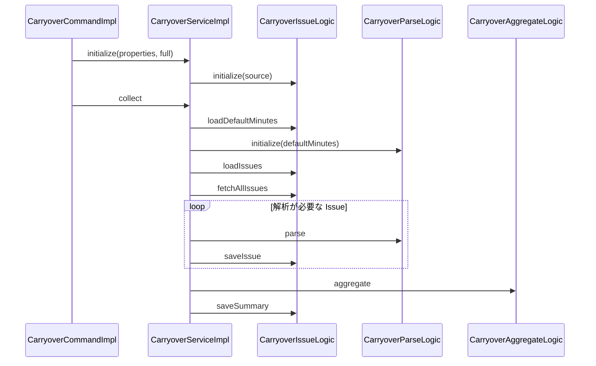

# 03. 収集処理

[設計書の目次へ戻る](../backend.md)

## コマンド

[CarryoverCommandImpl](https://github.com/KenichiroArai/gr002_daily-tasks/blob/main/src/main/java/kmg/gr/gr002/dailytasks/carryover/presentation/command/impl/CarryoverCommandImpl.java) が引数を解釈します。収集するときは `ObjectProvider` で新しい [CarryoverService](https://github.com/KenichiroArai/gr002_daily-tasks/blob/main/src/main/java/kmg/gr/gr002/dailytasks/carryover/presentation/service/CarryoverService.java) を取り、`initialize` してから `collect` を呼びます。サービスは収集の設定をフィールドに持つため、実行のたびに新しいインスタンスを使います。受け付ける引数は次の 3 つだけです。不明な引数は `IllegalArgumentException` です。

| 引数      | 定数                              | 動作                                       |
| --------- | --------------------------------- | ------------------------------------------ |
| `--full`  | `CommandOptionTypes.FULL`         | 全件モード。すべての Issue を解析し直す    |
| `--help`  | `CommandOptionTypes.HELP`         | 使い方を標準出力に出して終わる             |
| `-h`      | `CommandOptionTypes.HELP_SHORT`   | `--help` と同じ                            |

引数を付けない実行は差分モードです。`--help` または `-h` があるときは収集しません。

## collect の流れ

[CarryoverServiceImpl#collect](https://github.com/KenichiroArai/gr002_daily-tasks/blob/main/src/main/java/kmg/gr/gr002/dailytasks/carryover/application/service/impl/CarryoverServiceImpl.java) が、取得、解析、保存、集計をこの順で行います。`collect` は引数を取りません。設定とモードは、その前の `initialize` でフィールドに入っています。戻り値は、解析して保存した Issue の件数です。

1. 設定を `CarryoverSourceModel` に変換し、取得元、`recentCount`、全件モードかをフィールドに保持する。取得・保存ロジックも同じ取得元で初期化し、その中で外部 API と DAO を初期化する
2. 標準時間を読み込み、解析ロジックをその標準時間で初期化する。標準時間はサービスの入力ではなく、収集の途中で得る値のため、`collect` の中で初期化する
3. 保存済みの `issues/NNNN.json` を Issue 番号の昇順（`TreeMap`）で読み込む
4. 対象リポジトリの Issue をすべて取得する
5. 解析が必要な Issue だけを解析して上書き保存する。解析しなかった Issue は、手順 3 の内容を集計に使う
6. メモリ上の全解析結果から `summary.json` を作り直し、保存する
7. モード、取得件数、解析件数、集計した日数、標準時間で補完した件数、時間を決められなかった件数をログに出す

Issue の一覧は毎回すべて取得します。解析と保存を省くかどうかは、次の差分判定で決めます。

## 差分判定

`needsUpdate` が、その Issue を解析し直すかを返します。

| 条件                                       | 結果           |
| ------------------------------------------ | -------------- |
| 全件モード                                 | 解析し直す     |
| 保存済みの JSON がない                     | 解析し直す     |
| Issue 番号が `recentFrom` 以上             | 解析し直す     |
| 保存済みの `updatedAt` と取得した値が違う  | 解析し直す     |
| 上記以外                                   | 保存済みを使う |

`recentFrom` は、取得した Issue 番号を大きい順に `recentCount` 件（既定は 10）取り、その中の最小の番号です。Issue が無い場合は 0 です。モードの意味（最新 10 件は毎回解析する、それより前は更新されたものだけ、集計は毎回作り直す）は [Issue 解析の仕様](../../carryover-spec.md) の「収集のモード」に書きます。

## 解析

[CarryoverParseLogicImpl#parse](https://github.com/KenichiroArai/gr002_daily-tasks/blob/main/src/main/java/kmg/gr/gr002/dailytasks/carryover/domain/logic/impl/CarryoverParseLogicImpl.java) が、1 件の Issue から `CarryoverIssueModel` を作ります。標準時間は `initialize` で保持したフィールドを使います。

- 日付はタイトルから取る
- 対象セクションのチェックリスト行を項目にする
- 時間表記がない行は標準時間で補完する
- 本文の `残：N` と解析件数を比べ、食い違う場合は警告ログを出す

対象セクション、時間表記、項目名の正規化、`declaredCount` の規則は [Issue 解析の仕様](../../carryover-spec.md) を参照してください。正規表現は `CarryoverParsePatternTypes`、日付書式などの固定文字列は `CarryoverParseTextTypes`、対象セクション名は `TargetSectionTypes` に置きます。

## 集計

[CarryoverAggregateLogicImpl#aggregate](https://github.com/KenichiroArai/gr002_daily-tasks/blob/main/src/main/java/kmg/gr/gr002/dailytasks/carryover/domain/logic/impl/CarryoverAggregateLogicImpl.java) が、解析結果の集まりから `CarryoverSummaryModel` を作ります。

1. 日付がある Issue を、日付の昇順、同じ日付なら Issue 番号の昇順に並べる
2. 対象セクションが最初に現れた Issue から集計を始める。それより前の Issue は日別の行にしない
3. 集計を始めたあとの Issue は、対象セクションが無い日も 0 件の日として残す
4. 各項目を、その日の合計、項目ごと、持ち越し元の月ごとに足す。持ち越し元の日付が無い行は月ごとの集計に含めない。月は `originDate` の先頭 7 文字（`YYYY-MM`）とする
5. 項目名は、延べ件数の多い順、同じ件数なら名前の昇順に並べる
6. `latestIssue` は、渡された解析結果の Issue 番号の最大値とする。解析結果が空なら 0 とする

`summary.json` の項目の意味は [Issue 解析の仕様](../../carryover-spec.md) を参照してください。

## Issue の取得

[GitHubIssueApiImpl](https://github.com/KenichiroArai/gr002_daily-tasks/blob/main/src/main/java/kmg/gr/gr002/dailytasks/carryover/repository/api/github/GitHubIssueApiImpl.java) が GitHub REST API から Issue を取得します。接続設定は `initialize` でフィールドに保持し、`fetchAllIssues` は引数を取りません。

| 項目           | 値                                                                 |
| -------------- | ------------------------------------------------------------------ |
| 1 ページの件数 | 100。応答の件数が 100 未満になるまでページを進める                 |
| タイムアウト   | 30 秒                                                              |
| 成功           | HTTP ステータス 200                                                |
| 認証           | トークンがあるときだけ `Authorization` ヘッダを付ける              |
| 固定文字列     | URL、ヘッダ、空文字、応答の項目名は repository の `XxxTypes` に置く |

テストでは GitHub API へ実通信しません。`HttpClient` を生成するフィールドを差し替えます。
