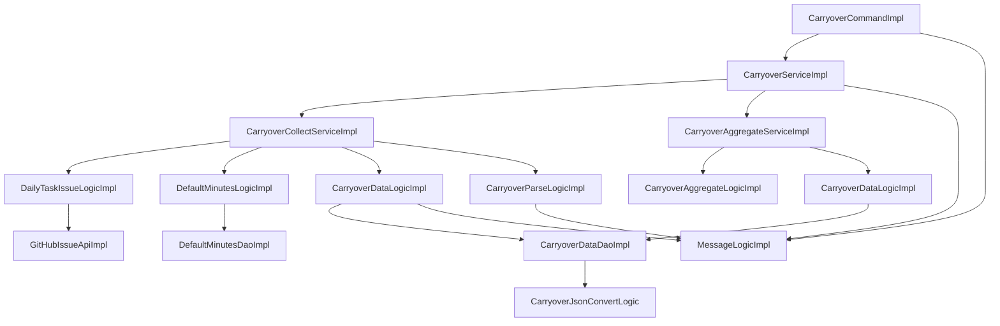

# 04. モジュール設計

[設計書の目次へ戻る](../backend.md)

## 処理の全体像

コマンドは実行のたびに新しいサービスを取り、`initialize` してから `collect`、続けて `aggregate` を呼びます。統合サービスが収集サービスと集計サービスに仕事を分け、各サービスが役割ごとのロジックを呼びます。ファイルと GitHub API へのアクセスは、domain のロジックが DTO に変換してから repository に渡します。接続設定や保存先は、各呼び出しの引数ではなく `initialize` で渡して、受け取る側がフィールドに保持します。

サービスは一連の流れを行い、ロジックは個々の処理を行います。役割が複数あるサービスは、統合サービスを残して役割ごとに分けます。ロジックのメソッド同士の依存は薄く、共通のパラメータだけをフィールドで共有します。ロジックはサービスを呼びません。状態を持つサービス、ロジック、外部 API、DAO は prototype です。

## presentation

| 型                          | 種類         | 役割                                                                 |
| --------------------------- | ------------ | -------------------------------------------------------------------- |
| `CarryoverCommand`          | インタフェース | `CommandLineRunner`。実装は `CarryoverCommandImpl`                 |
| `CarryoverCommandImpl`      | 実装         | 引数をフィールドに取り、使い方の表示か、新しいサービスの `initialize`、`collect`、`aggregate` を行う |
| `CarryoverService`          | インタフェース | application に求める収集と集計。実装は `CarryoverServiceImpl`      |
| `CarryoverPropertiesModel`  | モデル       | `carryover.*` の設定。文字列と変換後の `Path` を持つ               |
| `CommandOptionTypes`        | 列挙型       | `--full`、`--help`、`-h`                                             |
| `CarryoverPropertiesFormatTypes` | 列挙型  | 設定値の文字列表現                                                   |

## application

| 型                         | 種類         | 役割                                                                 |
| -------------------------- | ------------ | -------------------------------------------------------------------- |
| `CarryoverServiceImpl`     | サービス     | 収集と集計のサービスを順に呼ぶ。全件モードか、解析結果、取得件数、保存件数をフィールドに持つ。結果のログ |
| `CarryoverCollectService`  | インタフェース | 取得、差分判定、解析、Issue の保存。実装は `CarryoverCollectServiceImpl` |
| `CarryoverCollectServiceImpl` | サービス  | 取得元、最新件数、全件モードかをフィールドに持つ。`fetch`、`analyze`、`saveIssues` |
| `CarryoverAggregateService` | インタフェース | 日別集計と summary の保存。実装は `CarryoverAggregateServiceImpl` |
| `CarryoverAggregateServiceImpl` | サービス | 集計を作り、`summary.json` を保存する |
| `DailyTaskIssueLogic`      | インタフェース | 日々のタスク Issue の取得。実装は `DailyTaskIssueLogicImpl` |
| `DefaultMinutesLogic`      | インタフェース | 項目ごとの標準時間の読み込み。実装は `DefaultMinutesLogicImpl` |
| `CarryoverDataLogic`       | インタフェース | 解析結果と画面用の集計の読み書き。実装は `CarryoverDataLogicImpl` |
| `CarryoverParseLogic`      | インタフェース | 標準時間をフィールドに持つ。Issue 本文の解析。実装は `CarryoverParseLogicImpl` |
| `CarryoverAggregateLogic`  | インタフェース | 日別集計。実装は `CarryoverAggregateLogicImpl`                      |
| `CarryoverSourceModel`     | モデル       | サービスが保持する取得元と保存先。役割ごとの値を各ロジックへ渡す     |
| `DailyTaskIssueModel`      | モデル       | 取得した Issue（本文つき）                                           |
| `CarryoverIssueModel`      | モデル       | 1 Issue の解析結果                                                   |
| `CarryoverIssuesModel`     | モデル       | Issue 番号と解析結果の対応。番号順に保持する                         |
| `CarryoverItemModel`       | モデル       | 1 行の持ち越し項目                                                   |
| `DefaultMinutesModel`      | モデル       | 項目ごとの標準時間。`find` で引く                                    |
| `CarryoverSummaryModel`    | モデル       | 画面用の集計                                                         |
| `DailySummaryModel`        | モデル       | 1 日分の集計。`add` で項目を足す                                     |
| `ItemStatModel`            | モデル       | 件数と残り時間                                                       |
| `ItemStatsModel`           | モデル       | 項目名または月と集計値の対応                                         |
| `MinutesSourceTypes`       | 列挙型       | 残り時間の取得元（解析、標準時間、不明）                             |
| `IssueStateTypes`          | 列挙型       | Issue の状態                                                         |
| `CarryoverSourceFormatTypes` | 列挙型     | 取得元の文字列表現                                                   |

取得、標準時間、読み書きの実装は domain の `DailyTaskIssueLogicImpl`、`DefaultMinutesLogicImpl`、`CarryoverDataLogicImpl` です。解析と集計の実装も domain です。application のサービスは、ロジックのインタフェースだけを使います。

## domain

| 型                          | 種類         | 役割                                                                 |
| --------------------------- | ------------ | -------------------------------------------------------------------- |
| `DailyTaskIssueLogicImpl`   | ロジック     | リポジトリとトークンから接続設定を作り、API を初期化する。変換は変換先の型が行う |
| `DefaultMinutesLogicImpl`   | ロジック     | 標準時間の設定ファイルで DAO を初期化し、読み込んだ対応をモデルにする |
| `CarryoverDataLogicImpl`    | ロジック     | 出力先で DAO を初期化する。解析結果と集計の変換は変換先の型が行う |
| `CarryoverParseLogicImpl`   | ロジック     | 標準時間をフィールドに持つ。本文の解析。規則の詳細は [Issue 解析の仕様](../../carryover-spec.md) |
| `CarryoverAggregateLogicImpl` | ロジック   | 日別集計。手順は [03. 収集処理](03-processing.md)                    |
| `GitHubIssueApi`            | インタフェース | Issue 一覧の取得。実装は repository                                  |
| `CarryoverDataDao`          | インタフェース | 解析結果と集計の JSON の読み書き                                     |
| `DefaultMinutesDao`         | インタフェース | 標準時間の設定ファイルの読み込み                                     |
| `GitHubIssueDto`            | DTO          | API から取り出した Issue。`toDailyTaskIssueModel` でモデルにする     |
| `GitHubSettingsDto`         | DTO          | API の接続設定。リポジトリとトークンから作る                         |
| `CarryoverIssueDto`         | DTO          | 保存する解析結果。モデルから作り、`toCarryoverIssueModel` で戻す     |
| `CarryoverIssuesDto`        | DTO          | Issue 番号と解析結果の対応。`toCarryoverIssuesModel` でモデルにする  |
| `CarryoverItemDto`          | DTO          | 保存する持ち越し項目。取得元は文字列                                 |
| `CarryoverSummaryDto`       | DTO          | 保存する日別集計。集計モデルから作る                                 |
| `DailySummaryDto`           | DTO          | 1 日分の集計                                                         |
| `DefaultMinutesDto`         | DTO          | 項目ごとの標準時間。`toDefaultMinutesModel` でモデルにする           |
| `ItemStatDto`               | DTO          | 件数と残り時間                                                       |
| `ItemStatsDto`              | DTO          | 項目名または月と集計値の対応                                         |
| `TargetSectionTypes`        | 列挙型       | 対象セクション名                                                     |
| `CarryoverParsePatternTypes`| 列挙型       | 解析の正規表現                                                       |
| `CarryoverParseTextTypes`   | 列挙型       | 日付書式などの固定文字列                                             |
| `GitHubSettingsFormatTypes` | 列挙型       | 接続設定の文字列表現                                                 |

## infrastructure

| 型                 | 種類         | 役割                                                                 |
| ------------------ | ------------ | -------------------------------------------------------------------- |
| `MessageLogic`     | インタフェース | メッセージキーから文面を返す。実装は `MessageLogicImpl`            |
| `MessageLogicImpl` | ロジック     | Spring の `MessageSource` を引数なしで引く。`{}` や `%s` はそのまま返す |
| `Gr002GenMsgTypes` | 列挙型       | 使い方と例外。コードは `GR002_GEN11xxx`                              |
| `Gr002LogMsgTypes` | 列挙型       | ログ。コードは `GR002_LOG12xxx`                                      |
| `Gr002ValMsgTypes` | 列挙型       | バリデーション。コードは `GR002_VAL13xxx`。該当がなければ `NONE` だけ |

メッセージの取得とプロパティの対応は [05. 品質・運用](05-quality.md) です。

## repository

| 型                         | 種類     | 役割                                                                 |
| -------------------------- | -------- | -------------------------------------------------------------------- |
| `GitHubIssueApiImpl`       | 外部 API | 接続設定をフィールドに持つ。Issue をページングして取得し、`GitHubIssueDto` を作る |
| `CarryoverDataDaoImpl`     | DAO      | 出力先をフィールドに持つ。`issues/NNNN.json` の読み書きと `summary.json` の書き出し |
| `DefaultMinutesDaoImpl`    | DAO      | 設定ファイルのパスをフィールドに持つ。`default-minutes.json` を読み、`DefaultMinutesDto` にする |
| `CarryoverJsonConvertLogic`| ロジック | domain の DTO と JSON 用 DTO の相互変換                              |
| `CarryoverIssueJsonDto`    | JSON     | Issue ごとのファイルの形                                             |
| `CarryoverItemJsonDto`     | JSON     | 項目の形                                                             |
| `CarryoverSummaryJsonDto`  | JSON     | `summary.json` の形                                                  |
| `DailySummaryJsonDto`      | JSON     | 1 日分の形                                                           |
| `ItemStatJsonDto`          | JSON     | 件数と残り時間の形                                                   |
| `ItemStatsJsonDto`         | JSON     | 項目名または月と集計値の形。JSON では動的キーのオブジェクト          |
| `CarryoverDataFileTypes`   | 列挙型   | `issues`、`.json`、`summary.json`                                    |
| `CarryoverDataFormatTypes` | 列挙型   | インデント、改行、4 桁ゼロ埋めの書式                                 |
| `GitHubApiUrlTypes`        | 列挙型   | GitHub API の URL                                                    |
| `GitHubApiHeaderTypes`     | 列挙型   | リクエストヘッダ                                                     |
| `GitHubApiTextTypes`       | 列挙型   | 空文字などの固定文字列                                               |
| `GitHubIssueFieldTypes`    | 列挙型   | 応答 JSON の項目名                                                   |

`CarryoverDataDao` の読み込みは Issue ごとの JSON だけを返し、集計ファイルは読み戻しません。集計は収集のたびに作り直すためです。
