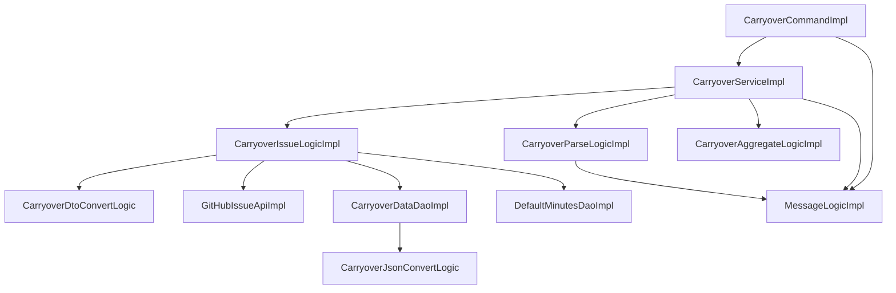

# 04. モジュール設計

[設計書の目次へ戻る](../backend.md)

## 処理の全体像

コマンドがサービスの `collect` を呼び、サービスが 3 つのロジックに仕事を分けます。ファイルと GitHub API へのアクセスは、domain の取得・保存ロジックが DTO に変換してから repository に渡します。

サービスは一連の流れを行い、ロジックは個々の処理を行います。ロジックはサービスを呼びません。

## presentation

| 型                          | 種類         | 役割                                                                 |
| --------------------------- | ------------ | -------------------------------------------------------------------- |
| `CarryoverCommand`          | インタフェース | `CommandLineRunner`。実装は `CarryoverCommandImpl`                 |
| `CarryoverCommandImpl`      | 実装         | 引数を `CarryoverOptionsModel` にし、使い方の表示か `collect` を行う |
| `CarryoverService`          | インタフェース | application に求める収集。実装は `CarryoverServiceImpl`            |
| `CarryoverPropertiesModel`  | モデル       | `carryover.*` の設定。文字列と変換後の `Path` を持つ               |
| `CarryoverOptionsModel`     | モデル       | 引数の結果。全件モードか、使い方を表示するか                         |
| `CommandOptionTypes`        | 列挙型       | `--full`、`--help`、`-h`                                             |
| `CarryoverPropertiesFormatTypes` | 列挙型  | 設定値の文字列表現                                                   |

## application

| 型                         | 種類         | 役割                                                                 |
| -------------------------- | ------------ | -------------------------------------------------------------------- |
| `CarryoverServiceImpl`     | サービス     | 取得、差分判定、解析、保存、集計、結果のログ                         |
| `CarryoverIssueLogic`      | インタフェース | 標準時間の読み込み、Issue の取得、解析結果と集計の読み書き          |
| `CarryoverParseLogic`      | インタフェース | Issue 本文の解析。実装は `CarryoverParseLogicImpl`                  |
| `CarryoverAggregateLogic`  | インタフェース | 日別集計。実装は `CarryoverAggregateLogicImpl`                      |
| `CarryoverSourceModel`     | モデル       | domain に渡す取得元と保存先                                          |
| `DailyTaskIssueModel`      | モデル       | 取得した Issue（本文つき）                                           |
| `CarryoverIssueModel`      | モデル       | 1 Issue の解析結果                                                   |
| `CarryoverItemModel`       | モデル       | 1 行の持ち越し項目                                                   |
| `DefaultMinutesModel`      | モデル       | 項目ごとの標準時間                                                   |
| `CarryoverSummaryModel`    | モデル       | 画面用の集計                                                         |
| `DailySummaryModel`        | モデル       | 1 日分の集計。`add` で項目を足す                                     |
| `ItemStatModel`            | モデル       | 件数と残り時間                                                       |
| `MinutesSourceTypes`       | 列挙型       | 残り時間の取得元（解析、標準時間、不明）                             |
| `IssueStateTypes`          | 列挙型       | Issue の状態                                                         |
| `CarryoverSourceFormatTypes` | 列挙型     | 取得元の文字列表現                                                   |

`CarryoverIssueLogic` の実装は domain の `CarryoverIssueLogicImpl` です。application はこのインタフェースだけを使います。

## domain

| 型                          | 種類         | 役割                                                                 |
| --------------------------- | ------------ | -------------------------------------------------------------------- |
| `CarryoverIssueLogicImpl`   | ロジック     | API と DAO を呼び、モデルと DTO を変換する                           |
| `CarryoverParseLogicImpl`   | ロジック     | 本文の解析。規則の詳細は [Issue 解析の仕様](../../carryover-spec.md) |
| `CarryoverAggregateLogicImpl` | ロジック   | 日別集計。手順は [03. 収集処理](03-processing.md)                    |
| `CarryoverDtoConvertLogic`  | ロジック     | application のモデルと domain の DTO の相互変換                      |
| `GitHubIssueApi`            | インタフェース | Issue 一覧の取得。実装は repository                                  |
| `CarryoverDataDao`          | インタフェース | 解析結果と集計の JSON の読み書き                                     |
| `DefaultMinutesDao`         | インタフェース | 標準時間の設定ファイルの読み込み                                     |
| `GitHubIssueDto`            | DTO          | API から取り出した Issue                                             |
| `GitHubSettingsDto`         | DTO          | API の接続設定（リポジトリ、トークン）                               |
| `CarryoverIssueDto`         | DTO          | 保存する解析結果。件数と残り時間の合計を持つ                         |
| `CarryoverItemDto`          | DTO          | 保存する持ち越し項目。取得元は文字列                                 |
| `CarryoverSummaryDto`       | DTO          | 保存する日別集計                                                     |
| `DailySummaryDto`           | DTO          | 1 日分の集計                                                         |
| `ItemStatDto`               | DTO          | 件数と残り時間                                                       |
| `TargetSectionTypes`        | 列挙型       | 対象セクション名                                                     |
| `CarryoverParsePatternTypes`| 列挙型       | 解析の正規表現                                                       |
| `CarryoverParseTextTypes`   | 列挙型       | 日付書式などの固定文字列                                             |
| `GitHubSettingsFormatTypes` | 列挙型       | 接続設定の文字列表現                                                 |

## infrastructure

| 型                 | 種類         | 役割                                                                 |
| ------------------ | ------------ | -------------------------------------------------------------------- |
| `MessageLogic`     | インタフェース | メッセージキーから文面を返す。実装は `MessageLogicImpl`            |
| `MessageLogicImpl` | ロジック     | Spring の `MessageSource` を引数なしで引く。`{}` や `%s` はそのまま返す |
| `Gr002GenMsgTypes` | 列挙型       | 使い方と例外。コードは `GR002_GEN11xxx`                              |
| `Gr002LogMsgTypes` | 列挙型       | ログ。コードは `GR002_LOG12xxx`                                      |
| `Gr002ValMsgTypes` | 列挙型       | バリデーション。コードは `GR002_VAL13xxx`。該当がなければ `NONE` だけ |

メッセージの取得とプロパティの対応は [05. 品質・運用](05-quality.md) です。

## repository

| 型                         | 種類     | 役割                                                                 |
| -------------------------- | -------- | -------------------------------------------------------------------- |
| `GitHubIssueApiImpl`       | 外部 API | Issue をページングして取得し、`GitHubIssueDto` を作る                |
| `CarryoverDataDaoImpl`     | DAO      | `issues/NNNN.json` の読み書きと `summary.json` の書き出し            |
| `DefaultMinutesDaoImpl`    | DAO      | `default-minutes.json` を `Map<String, Double>` として読む           |
| `CarryoverJsonConvertLogic`| ロジック | domain の DTO と JSON 用 DTO の相互変換                              |
| `CarryoverIssueJsonDto`    | JSON     | Issue ごとのファイルの形                                             |
| `CarryoverItemJsonDto`     | JSON     | 項目の形                                                             |
| `CarryoverSummaryJsonDto`  | JSON     | `summary.json` の形                                                  |
| `DailySummaryJsonDto`      | JSON     | 1 日分の形                                                           |
| `ItemStatJsonDto`          | JSON     | 件数と残り時間の形                                                   |
| `CarryoverDataFileTypes`   | 列挙型   | `issues`、`.json`、`summary.json`                                    |
| `CarryoverDataFormatTypes` | 列挙型   | インデント、改行、4 桁ゼロ埋めの書式                                 |
| `GitHubApiUrlTypes`        | 列挙型   | GitHub API の URL                                                    |
| `GitHubApiHeaderTypes`     | 列挙型   | リクエストヘッダ                                                     |
| `GitHubApiTextTypes`       | 列挙型   | 空文字などの固定文字列                                               |
| `GitHubIssueFieldTypes`    | 列挙型   | 応答 JSON の項目名                                                   |

`CarryoverDataDao` の読み込みは Issue ごとの JSON だけを返し、集計ファイルは読み戻しません。集計は収集のたびに作り直すためです。
