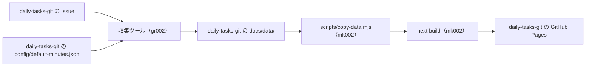

# 全体構成

日々のタスク（GitHub Issue、1 日 1 Issue）の「持ち越し」（旧「繰り越し」「負債」）を集計し、グラフとして GitHub Pages に公開する仕組みの全体像です。

## リポジトリの役割

daily-tasks-git を基軸とし、プログラム部分を KMG シリーズの第 2 弾（`gr002`・`mk002`・`kb002`）のリポジトリに分けています。

| リポジトリ                                                                                | 種類           | 役割                                                                                             |
| ----------------------------------------------------------------------------------------- | -------------- | ------------------------------------------------------------------------------------------------ |
| [daily-tasks-git](https://github.com/KenichiroArai/daily-tasks-git)                       | 基軸           | 日々のタスクの Issue、ワークフロー、設定ファイル（`config/`）、出力データ（`docs/data/`）、Pages |
| [gr002_daily-tasks](https://github.com/KenichiroArai/gr002_daily-tasks)                   | バックエンド   | 収集ツール（Java 25 / Maven / Spring Boot 4）。Issue を取得・解析し、JSON を出力する             |
| [mk002_daily-tasks_web-next](https://github.com/KenichiroArai/mk002_daily-tasks_web-next) | フロントエンド | 画面（Next.js + TypeScript + Recharts の静的エクスポート）                                       |
| [kb002_daily-tasks_doc](https://github.com/KenichiroArai/kb002_daily-tasks_doc)           | ドキュメント   | 設計書と、バックエンド・フロントエンドに横断的なドキュメント（本リポジトリ）                     |

## ローカルの配置

4 つのリポジトリを同じフォルダの下に兄弟ディレクトリとして置きます。収集ツールと画面は、兄弟の daily-tasks-git を相対パスで参照します。

```text
daily-tasks_wk/
  daily-tasks-git/             # 基軸（.github/、config/、docs/data/）
  gr002_daily-tasks/           # 収集ツール（pom.xml、src/）
  mk002_daily-tasks_web-next/  # 画面（package.json、src/、scripts/）
  kb002_daily-tasks_doc/       # ドキュメント（docs/）
```

- 収集ツールの jar は daily-tasks-git をカレントディレクトリにして実行します（`config/default-minutes.json` を読み、`docs/data/` に出力する）
- 画面は `dev` / `build` の前に `../daily-tasks-git/docs/data` を `public/data/` にコピーします（環境変数 `CARRYOVER_DATA_DIR` で変更可能）

## データの流れ



- Issue の解析と JSON の形式は [Issue 解析の仕様](carryover-spec.md) を参照してください
- 画面の設計は [フロントエンド設計書](design/frontend.md) を参照してください
- 収集ツールの設計は [バックエンド設計書](design/backend.md) を参照してください

## 収集と公開（GitHub Actions）

daily-tasks-git の [update-carryover.yml](https://github.com/KenichiroArai/daily-tasks-git/blob/main/.github/workflows/update-carryover.yml) が、収集から公開までを行います。

- トリガー: 毎日 06:00（JST）のスケジュールと、手動実行（`full` 入力で全件モード）。Issue の編集ごとにコミットされないよう、Issue イベントでは動かしません
- daily-tasks-git、gr002_daily-tasks、mk002_daily-tasks_web-next を兄弟ディレクトリとしてチェックアウトします（いずれも public のため、チェックアウト用の追加トークンは不要）
- gr002_daily-tasks をビルド（テストを含む）し、daily-tasks-git をカレントにして jar を実行します。依存の kmg-core と kmg-fund は GitHub Packages から取得し、`packages: read` の `GITHUB_TOKEN` で認証します。両パッケージで daily-tasks-git に Actions からの読み取りを許可します
- `docs/data/` に差分があれば daily-tasks-git にコミットしてプッシュします
- mk002_daily-tasks_web-next をビルド（lint・型チェック・テストを含む）し、`out/` を GitHub Pages にデプロイします。basePath は `actions/configure-pages` の出力を環境変数 `PAGES_BASE_PATH` で渡します
- GitHub Pages の Source は「GitHub Actions」にします
- gr002・mk002 の変更は、次回のワークフローの実行時（スケジュールまたは手動）に反映されます

## ドキュメントの置き場所

| 内容                                                         | 置き場所                                    |
| ------------------------------------------------------------ | ------------------------------------------- |
| 全体構成、Issue 解析の仕様、共通のコーディングルール、設計書 | kb002_daily-tasks_doc の `docs/`            |
| Java の構成ルールとコーディングルール                        | gr002_daily-tasks の `AGENTS.md`            |
| 画面の構成ルールと TypeScript のコーディングルール           | mk002_daily-tasks_web-next の `AGENTS.md`   |
| ワークフロー、データ、公開ページ                             | daily-tasks-git の `AGENTS.md`・`README.md` |
